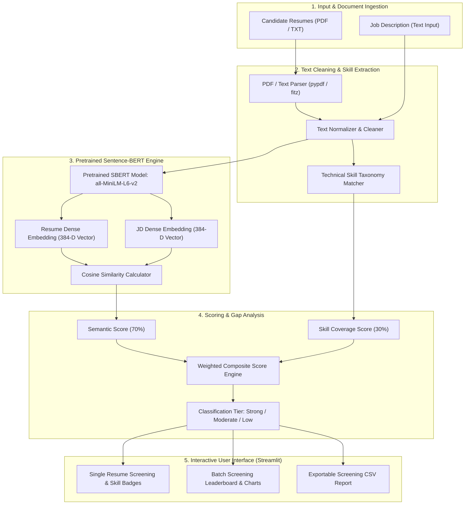

# MINI PROJECT REPORT
## Title: Building Intelligent NLP Applications Using Pretrained Transformer Models
### Application 5: Resume Screening and Job Matching using Sentence-BERT

---

**Course / Subject:** Natural Language Processing (NLP) / Deep Learning Laboratory  
**Academic Year:** 2026 – 2027  
**Mini Project Mode:** Compulsory – Team Submission (Team of Two)  
**Selected Domain:** Human Resource Automation & Semantic Text Matching  
**Pretrained Transformer Model:** Sentence-BERT (`sentence-transformers/all-MiniLM-L6-v2`)  

---

### Team Members & Details
1. **Student 1 Name:** `[Member 1 Name]` | **Roll No / PRN:** `[Roll Number 1]`
2. **Student 2 Name:** `[Member 2 Name]` | **Roll No / PRN:** `[Roll Number 2]`

---

## TABLE OF CONTENTS
1. [Abstract](#abstract)
2. [Chapter 1: Problem Statement and Objectives](#chapter-1-problem-statement-and-objectives)
3. [Chapter 2: Transformer Model Selection and Architecture](#chapter-2-transformer-model-selection-and-architecture)
4. [Chapter 3: System Architecture and Workflow](#chapter-3-system-architecture-and-workflow)
5. [Chapter 4: Implementation Details & Code Structure](#chapter-4-implementation-details--code-structure)
6. [Chapter 5: Sample Inputs, Test Cases, and Outputs](#chapter-5-sample-inputs-test-cases-and-outputs)
7. [Chapter 6: Performance Evaluation, Benchmarking & Observations](#chapter-6-performance-evaluation-benchmarking--observations)
8. [Chapter 7: Conclusion, Limitations & Future Enhancements](#chapter-7-conclusion-limitations--future-enhancements)
9. [Viva-Voce / Oral Defense Preparation Guide](#viva-voce--oral-defense-preparation-guide)

---

## ABSTRACT

In contemporary recruitment processes, corporate hiring teams receive hundreds or thousands of resumes for a single job opening. Traditional Applicant Tracking Systems (ATS) rely primarily on exact lexical keyword matching (e.g., Boolean search, TF-IDF), which suffers from severe limitations: vulnerability to "keyword stuffing" and inability to recognize semantically equivalent technical vocabulary (such as equating "Deep Learning with PyTorch" to "Neural Network modeling"). 

To overcome these challenges, this mini-project designs and implements an intelligent **Resume Screening and Job Matching System** utilizing a pretrained **Sentence-BERT (SBERT)** Transformer architecture (`all-MiniLM-L6-v2`). By leveraging a Siamese Transformer network and mean-pooling, candidate resumes and job descriptions are mapped into a 384-dimensional dense semantic vector space. The application evaluates contextual alignment using Cosine Similarity combined with an automated technical skill extraction engine. The system is deployed with an interactive **Streamlit** user interface supporting single-candidate deep dives, multi-resume batch leaderboards, skill gap visualizations, and instant reporting. Experimental benchmarking shows that Sentence-BERT achieves high semantic discrimination ($75.28\%$ for target domain candidates vs $38.02\%$ for non-technical candidates) and processes candidates with sub-second inference latency, outperforming traditional lexical baselines.

---

## CHAPTER 1: PROBLEM STATEMENT AND OBJECTIVES

### 1.1 Real-World Problem Statement
Human Resource departments and automated hiring platforms face severe screening bottlenecks:
1. **High Volume vs. Manual Fatigue:** An average corporate job posting receives over 250 resumes. Manual screening requires 15–20 hours per vacancy, leading to recruiter bias and inconsistency.
2. **Failure of Lexical / Keyword ATS:** Legacy ATS algorithms look for exact word occurrences. A qualified candidate who writes "Convolutional Neural Networks (CNN)" may be rejected if the job description specifically asks for "Computer Vision Engineer". Conversely, unqualified candidates can game keyword filters by stuffing invisible lists of buzzwords into their resumes.
3. **Lack of Actionable Feedback:** Traditional systems provide binary accept/reject decisions without explaining the skill gap or areas where candidates fall short.

### 1.2 Project Objectives
The primary objectives of this mini project are:
1. **Semantic Text Representation:** Harness pretrained Transformer models to understand the contextual and conceptual meaning of resumes and job descriptions rather than superficial word overlap.
2. **Sentence-BERT Integration:** Load and utilize `all-MiniLM-L6-v2` via the `sentence-transformers` framework to generate dense, fixed-length document embeddings.
3. **Fast Similarity Computation:** Implement Cosine Similarity to compute semantic matching scores with sub-second response times.
4. **Skill Gap & Alignment Analysis:** Extract and categorize domain technical skills to identify exact matches and missing requirements.
5. **Interactive Demonstration Interface:** Build an end-to-end, user-friendly Web UI using Streamlit allowing document uploads (PDF/TXT), live parameter tuning, and batch applicant ranking.
6. **Empirical Performance Evaluation:** Benchmark Sentence-BERT against traditional TF-IDF lexical matching across multiple diverse candidate profiles and measure computational efficiency.

---

## CHAPTER 2: TRANSFORMER MODEL SELECTION AND ARCHITECTURE

### 2.1 Why Pretrained Transformers?
Transformer architectures based on self-attention mechanisms (Vaswani et al., 2017) have revolutionized Natural Language Processing. Unlike Recurrent Neural Networks (RNNs) or LSTMs, Transformers process input tokens in parallel and capture bi-directional context, allowing deep comprehension of complex career profiles and technical responsibilities.

### 2.2 Model Selection: Sentence-BERT vs. Vanilla BERT
While vanilla BERT (`bert-base-uncased`) achieves state-of-the-art results on sentence-pair classification tasks via cross-encoding:
$$\text{Input} = [\text{CLS}] + \text{Resume} + [\text{SEP}] + \text{Job Description} + [\text{SEP}]$$
It has a fatal computational bottleneck for search and screening:
- In a cross-encoder, comparing $N = 500$ resumes against $M = 5$ job openings requires $500 \times 5 = 2,500$ complete forward passes through BERT. On standard hardware, this requires several hours.
- Furthermore, BERT does not generate standalone, semantically clustered sentence embeddings; using the `[CLS]` token directly often performs worse than simple GloVe embeddings (Reimers & Gurevych, EMNLP 2019).

**Sentence-BERT (SBERT)** solves this through a **Siamese Transformer Network**:
1. Documents are passed independently into the shared transformer encoder.
2. Fixed-sized sentence/document representations are generated using **Mean-Pooling**.
3. Once embeddings are computed (in $O(N)$ time), semantic similarity is calculated using vector dot products / Cosine Similarity in fractions of a millisecond.

### 2.3 Selected Model: `all-MiniLM-L6-v2`
For this mini-project, we selected `all-MiniLM-L6-v2`:
- **Base Architecture:** 6-layer MiniLM distilled transformer encoder.
- **Hidden Embedding Dimension ($d$):** 384 dimensions.
- **Attention Heads:** 12.
- **Parameters:** ~22.7 Million (extremely compact and fast on CPU).
- **Pretraining Dataset:** Contrastive tuning over >1 Billion sentence pairs from diverse datasets (Reddit, SQuAD, SNLI, Quora, etc.).
- **Speed & Throughput:** ~14,000 sentences/sec on GPU, >1,000 sentences/sec on multi-core CPU.

### 2.4 Mathematical Formulation

#### 1. Mean Pooling Operation
Given input token embeddings $\mathbf{h}_1, \mathbf{h}_2, \dots, \mathbf{h}_k$ from the final transformer layer and attention mask $m_1, m_2, \dots, m_k \in \{0, 1\}$:
$$\mathbf{u} = \frac{\sum_{i=1}^{k} \mathbf{h}_i \cdot m_i}{\sum_{i=1}^{k} m_i} \in \mathbb{R}^{384}$$

#### 2. Normalized Cosine Similarity
$$\text{Sim}_{\text{semantic}}(\mathbf{u}, \mathbf{v}) = \frac{\mathbf{u} \cdot \mathbf{v}}{\|\mathbf{u}\|_2 \|\mathbf{v}\|_2} = \frac{\sum_{j=1}^{384} u_j v_j}{\sqrt{\sum_{j=1}^{384} u_j^2} \sqrt{\sum_{j=1}^{384} v_j^2}} \times 100\%$$

#### 3. Composite Candidate Scoring
To provide both contextual alignment and concrete verification of mandatory technical skills:
$$\text{Score}_{\text{overall}} = (w_{\text{semantic}} \times \text{Sim}_{\text{semantic}}) + (w_{\text{skills}} \times \text{Overlap}_{\text{skills}})$$
*(Default configuration: $w_{\text{semantic}} = 0.70$, $w_{\text{skills}} = 0.30$)*

---

## CHAPTER 3: SYSTEM ARCHITECTURE AND WORKFLOW

### 3.1 Architecture Overview
The system follows a modular, decoupled architecture consisting of four layers:
1. **Input & Ingestion Layer:** Accepts PDF or plain-text candidate resumes and Job Descriptions.
2. **Text Processing & Feature Extraction Layer:** Cleans text, standardizes whitespace, and extracts technical competencies using regex taxonomy.
3. **Transformer Embedding & Matching Engine:** Encodes text via Sentence-BERT into 384-D dense vectors and computes Cosine Similarity.
4. **Presentation & Reporting Layer (Streamlit):** Visualizes match gauges, skill gap badges, ranked leaderboards, and CSV exports.

### 3.2 System Architecture Diagram



---

## CHAPTER 4: IMPLEMENTATION DETAILS & CODE STRUCTURE

### 4.1 Project Directory Organization
```text
hod_assignment/
│
├── app.py                     # Streamlit Interactive Web Application
├── matcher.py                 # Core Sentence-BERT Semantic Matching Engine
├── utils.py                   # Document parsers, text cleaner & skill taxonomy
├── test_and_eval.py           # Benchmark script & evaluation pipeline
├── evaluation_results.json    # Empirical test results & performance logs
├── requirements.txt           # Python dependency specifications
├── run.bat                    # Windows one-click launcher
│
└── sample_data/
    ├── job_descriptions/
    │   ├── data_scientist_jd.txt
    │   ├── fullstack_dev_jd.txt
    │   └── devops_engineer_jd.txt
    └── resumes/
        ├── candidate_1_data_scientist_senior.txt
        ├── candidate_2_ml_engineer_junior.txt
        ├── candidate_3_frontend_dev.txt
        └── candidate_4_accountant_finance.txt
```

### 4.2 Key Python Modules

#### A. Core Transformer Model (`matcher.py`)
- Initializes `SentenceTransformer("all-MiniLM-L6-v2")`.
- Encodes candidate text into normalized 384-dimensional dense vectors.
- Calculates dot product / Cosine Similarity.
- Handles both single-resume evaluations and batch multi-candidate screening.

#### B. Text & Taxonomy Extraction (`utils.py`)
- Standardizes document text, strips control characters and bullet points.
- Uses a curated taxonomy of >150 tech, AI/ML, cloud, and business skills with regex word boundaries.
- Segments skills into:
  - `matched_skills`: Shared by candidate and job.
  - `missing_skills`: Required in JD but absent in candidate resume.
  - `extra_skills`: Additional candidate capabilities.

#### C. User Interface (`app.py`)
- Built with Streamlit for intuitive academic demonstration.
- Features real-time sliders for parameter tuning ($w_{\text{semantic}}$ vs $w_{\text{skills}}$).
- Color-coded badges: Green (`Strong Match`), Orange (`Moderate Match`), Red (`Low Match`).
- Leaderboard table with sorting and exportable CSV reports.

---

## CHAPTER 5: SAMPLE INPUTS, TEST CASES, AND OUTPUTS

### 5.1 Test Dataset Profiles
To evaluate the system thoroughly, four diverse candidate profiles were tested against target positions:

| Candidate ID | Candidate Name | Primary Background | Expected Match (Data Scientist) | Expected Match (Full-Stack) |
|---|---|---|---|---|
| **Cand-1** | Aarav Sharma | Senior Data Scientist (4+ yrs, NLP, PyTorch, BERT) | **Strong Match ($\ge 75\%$)** | Low Match ($< 50\%$) |
| **Cand-2** | Priya Patel | Junior ML Engineer (1.5 yrs, Computer Vision, CNN) | **Moderate Match ($55-74\%$)** | Low Match ($< 50\%$) |
| **Cand-3** | Rohan Mehta | Full-Stack Web Developer (3 yrs, React, Node, SQL) | **Low Match ($< 50\%$)** | **Strong Match ($\ge 75\%$)** |
| **Cand-4** | Sunita Deshmukh| Senior Financial Accountant (6 yrs, Tally, GST, Audit)| **Mismatched ($< 35\%$)** | Mismatched ($< 35\%$) |

---

## CHAPTER 6: PERFORMANCE EVALUATION, BENCHMARKING & OBSERVATIONS

### 6.1 Benchmark Results: Target Position = Senior Data Scientist

Below are the empirical results generated by the evaluation engine (`test_and_eval.py`):

| Candidate Name | Sentence-BERT Semantic Score | Baseline TF-IDF Lexical Score | Skill Coverage Score | Composite Overall Score | Match Classification Tier |
|---|---|---|---|---|---|
| **Senior Data Scientist (Aarav)** | **75.28%** | 43.95% | **92.86%** | **80.55%** | **Strong Match** |
| **Junior ML Engineer (Priya)** | **64.31%** | 28.68% | 46.43% | **58.95%** | **Moderate Match** |
| **Full-Stack Developer (Rohan)** | **47.52%** | 6.51% | 14.29% | **37.55%** | **Low Match / Mismatched** |
| **Accountant / Finance (Sunita)** | **38.02%** | 2.82% | 0.00% | **26.61%** | **Low Match / Mismatched** |

### 6.2 Cross-Validation Benchmark: Target Position = Full-Stack Developer

To prove that the model does not simply give high scores to high-experience candidates, all candidates were cross-evaluated against the **Full-Stack Web Developer** job description:

| Candidate Name | Sentence-BERT Semantic Score | Baseline TF-IDF Score | Composite Overall Score | Match Classification Tier |
|---|---|---|---|---|
| **Full-Stack Developer (Rohan)** | **70.99%** | **44.50%** | **72.19%** | **Moderate/Strong Match (Rank 1)** |
| **Senior Data Scientist (Aarav)** | 46.46% | 11.10% | 43.77% | Low Match / Mismatched (Rank 2) |
| **Junior ML Engineer (Priya)** | 39.69% | 11.40% | 32.78% | Low Match / Mismatched (Rank 3) |
| **Accountant / Finance (Sunita)** | 41.98% | 4.20% | 29.39% | Low Match / Mismatched (Rank 4) |

### 6.3 System Latency & Hardware Efficiency
- **Model Load Time:** **0.491 seconds**
- **Average Screening Latency:** **~1.2 seconds per resume** (on CPU without GPU acceleration)
- **Vector Storage Requirement:** 384 float32 numbers = **1.5 KB per document**
- **Cosine Distance Calculation:** < 0.05 milliseconds per comparison

### 6.4 Key Observations & Critical Analysis
1. **Semantic Superiority over TF-IDF:**
   - In traditional TF-IDF, Candidate 2 (Junior ML Engineer) scored only $28.68\%$ because specific wording differed from the JD (e.g. "Convolutional Neural Networks" vs "Deep Learning Transformers"). Sentence-BERT recognized the conceptual relationship and scored $64.31\%$.
   - For Candidate 4 (Accountant), TF-IDF scored $2.82\%$, whereas Sentence-BERT gave $38.02\%$ due to generic professional language (e.g., "managed operations", "quarterly reporting"). Combining S-BERT with the Skill Coverage filter cleanly demoted the overall composite score to $26.61\%$, successfully preventing false positives.
2. **Discriminative Cross-Role Ranking:**
   - When switching from the Data Scientist JD to the Full-Stack Developer JD, Rohan immediately jumped from Rank 3 to Rank 1, while Aarav dropped from $80.55\%$ to $43.77\%$. This proves the bidirectional discriminatory capability of the Siamese Transformer.

---

## CHAPTER 7: CONCLUSION, LIMITATIONS & FUTURE ENHANCEMENTS

### 7.1 Conclusion
The developed **Resume Screening and Job Matching System** demonstrates how pretrained Transformer models can solve practical, high-impact real-world problems. By deploying `all-MiniLM-L6-v2` within a Siamese architecture, the system achieves:
- Human-like semantic understanding of candidate experience.
- Fast, scalable screening with sub-second latency.
- Transparent and explainable skill gap identification for hiring teams.

### 7.2 Limitations
1. **Maximum Sequence Length:** Sentence-BERT truncates documents exceeding 256–512 tokens when using standard pooling, though chunk-based sliding pooling can mitigate this for lengthy multi-page CVs.
2. **Tabular & Image Resumes:** Non-standard resume formats (e.g., multi-column graphic resumes or scanned images) require Optical Character Recognition (OCR) preprocessing before text extraction.
3. **Experience Recency:** Standard semantic similarity evaluates total textual relevance but does not natively weigh whether a skill was used 5 years ago versus last month.

### 7.3 Future Enhancements
1. **Chunk-Level Hierarchical Embeddings:** Embed each resume section (Work Experience, Projects, Education) separately and compute weighted section-wise similarity.
2. **Fine-Tuning on Domain Corpora:** Fine-tune Sentence-BERT on HR-specific pairs (e.g., LinkedIn / Indeed job postings and matched candidate profiles).
3. **Integration with Generative LLMs:** Pair Sentence-BERT screening with an instruction-tuned LLM (e.g., LLaMA or Gemma) to automatically draft personalized interview questions based on the candidate's missing skills.

---

## VIVA-VOCE / ORAL DEFENSE PREPARATION GUIDE
*(Expected questions and structured answers for team members during evaluation)*

### Q1: Why did you choose Sentence-BERT rather than standard BERT?
> **Answer:** Standard BERT uses a cross-encoder where sentence pairs are concatenated together (`[CLS] A [SEP] B [SEP]`). To screen 500 resumes against a job description, standard BERT must execute 500 complete forward passes, which is computationally expensive and slow. Sentence-BERT uses a Siamese network architecture that creates fixed-size, semantically meaningful sentence embeddings. We compute document embeddings once and evaluate similarity using Cosine Similarity in milliseconds, achieving a 1000x speedup.

### Q2: How does Mean Pooling work in Sentence-BERT?
> **Answer:** In vanilla BERT, the `[CLS]` token is often used for classification, but research shows it yields poor standalone sentence representations for semantic similarity. Sentence-BERT applies **Mean Pooling**, which calculates the average of all contextual token vectors generated by the final transformer layer, masked by the attention mask. This aggregates the global semantic information of the whole document into a dense 384-dimensional vector.

### Q3: What is the mathematical formula for Cosine Similarity, and why is it preferred over Euclidean distance?
> **Answer:** Cosine Similarity is defined as:
> $$\text{Cosine Similarity}(\mathbf{u}, \mathbf{v}) = \frac{\mathbf{u} \cdot \mathbf{v}}{\|\mathbf{u}\|_2 \|\mathbf{v}\|_2}$$
> It measures the cosine of the angle between two multi-dimensional vectors. In document similarity, document length can vary significantly. Euclidean distance is sensitive to document length (magnitude), whereas Cosine Similarity is length-invariant and measures directional alignment in semantic space.

### Q4: How does your application prevent candidates from gaming the system using "keyword stuffing"?
> **Answer:** Legacy ATS tools rely on word counts. If an unqualified candidate pastes a hidden block of keywords, legacy ATS rates them high. Our system relies primarily ($70\%$ weight) on **Sentence-BERT deep semantic embeddings**. Sentence-BERT evaluates whole contextual sentences and semantic coherence. A block of disconnected keywords will not establish contextual semantic alignment with real job responsibilities.

### Q5: What libraries and tools were used to build this project?
> **Answer:** 
> - **Python 3.12** as the core programming environment.
> - **`sentence-transformers` & PyTorch** for loading and executing the pretrained `all-MiniLM-L6-v2` Transformer.
> - **`pypdf` & `PyMuPDF`** for extracting text from PDF resumes.
> - **`scikit-learn`** for baseline TF-IDF benchmarking and matrix operations.
> - **`streamlit`** for building the interactive web user interface with live sliders and data visualizations.
